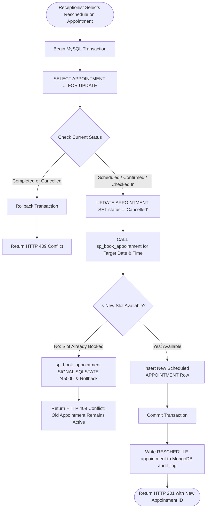

# Activity Diagrams
## Transactional Clinical & Operational Workflows

### 1. Receptionist Appointment Rescheduling Activity


---

### 2. Pharmacy FEFO Batch Dispensing Activity
```mermaid
flowchart TD
    Start([Pharmacist Clicks Confirm Dispense]) --> BeginTx[Begin MySQL Transaction]
    BeginTx --> LockPresc[SELECT PRESCRIPTION ... FOR UPDATE]
    LockPresc --> CheckDisp{Already Dispensed?}

    CheckDisp -- Yes --> RollbackDup[Rollback & Return HTTP 409 Conflict]
    CheckDisp -- No --> LoadItems[Fetch PRESCRIPTION_ITEM Rows]
    LoadItems --> LockBatches[SELECT MEDICINE_BATCH WHERE expiry_date >= CURDATE() AND available_qty > 0 ORDER BY expiry_date ASC FOR UPDATE]
    LockBatches --> CheckStock{Total Non-Expired Stock >= Requested Qty?}

    CheckStock -- No --> RollbackStock[Rollback & Return HTTP 409 Insufficient Non-Expired Stock]
    CheckStock -- Yes --> CreateHeader[INSERT INTO DISPENSING_RECORD]
    CreateHeader --> DeductLoop[Deduct from Earliest Expiring Batches First & INSERT INTO DISPENSING_ITEM]
    DeductLoop --> CheckLowStock[trg_low_stock_alert checks if total non-expired stock crossed below 20]
    CheckLowStock --> UpdateStatus[UPDATE PRESCRIPTION SET status = 'Dispensed']
    UpdateStatus --> CommitTx[Commit Transaction & Write MongoDB audit_log]
    CommitTx --> End([Return HTTP 200 OK])
```
