# System Architecture Document
## MediCare / MediVault – Smart Hospital & Emergency Management System

### 1. Architectural Overview
MediCare is designed using a multi-tiered, asynchronous client-server architecture powered by Node.js, Express, MariaDB/MySQL, and MongoDB. The system seamlessly integrates general hospital operations (Outpatient, Inpatient, Diagnostics, Pharmacy, Billing) with an Emergency Ward and the **Signature Emergency Priority Engine**.

```mermaid
graph TD
    subgraph Client Tier [Frontend - Vanilla JS + Bootstrap 5 + Semantic Dark Theme]
        WebBrowser["Modern Web Browsers (Chrome, Edge, Firefox)"]
        UIAdmin["Admin Dashboard & Ops Console"]
        UIEmergency["Emergency Ward & Triage Console"]
        UIDoctor["Doctor Clinical Workspace"]
        UINurse["Nurse Inpatient & Monitoring Portal"]
        UIStaff["Pharmacy, Lab & Billing Worklists"]
        UIPatient["Patient Portal & Scheduling Wizard"]
    end

    subgraph Application Tier [Backend - Express.js REST Core]
        AuthMW["Session & RBAC Middleware"]
        RouterAdmin["/api/admin"]
        RouterEmergency["/api/emergency (Priority Engine & Queue)"]
        RouterDoctor["/api/doctor"]
        RouterStaff["/api/staff (Nurse, Lab, Pharmacy)"]
        RouterResources["/api/resources (Blood Bank & Ambulance)"]
        RouterBilling["/api/billing"]
        RouterPatient["/api/patient"]
        NotifService["Notification Broadcaster Service"]
    end

    subgraph Data Tier [Dual Database Layer]
        subgraph Relational Engine [MariaDB / MySQL 10.4+]
            TablesCore["Relational Schema (ACID Transactions)"]
            T_Users["USER, DOCTOR, PATIENT, STAFF"]
            T_Appts["APPOINTMENT, CONSULTATION, MEDICAL_RECORD"]
            T_Beds["BED, ADMISSION, WARD"]
            T_Emergency["EMERGENCY_CASE, TRIAGE_ASSESSMENT, PRIORITY_LOG"]
            T_Pharmacy["MEDICINE, PRESCRIPTION, BILL"]
            T_Blood["BLOOD_INVENTORY, BLOOD_REQUEST"]
        end

        subgraph Document Engine [MongoDB 6.0+]
            Coll_Audit["audit_log (Immutable Clinical Trail)"]
            Coll_Lab["lab_reports_raw (Unstructured Payloads)"]
            Coll_Dispatch["ambulance_dispatch_log"]
        end
    end

    WebBrowser --> AuthMW
    AuthMW --> RouterAdmin
    AuthMW --> RouterEmergency
    AuthMW --> RouterDoctor
    AuthMW --> RouterStaff
    AuthMW --> RouterResources
    AuthMW --> RouterBilling
    AuthMW --> RouterPatient

    RouterEmergency --> NotifService
    RouterResources --> NotifService

    RouterAdmin --> TablesCore
    RouterEmergency --> TablesCore
    RouterDoctor --> TablesCore
    RouterStaff --> TablesCore
    RouterResources --> TablesCore
    RouterBilling --> TablesCore
    RouterPatient --> TablesCore

    RouterEmergency -.-> Coll_Audit
    RouterResources -.-> Coll_Dispatch
    RouterStaff -.-> Coll_Audit
    RouterDoctor -.-> Coll_Audit
    RouterStaff -.-> Coll_Lab
```

---

### 2. Dual Database Architecture
1. **Relational Layer (MySQL / MariaDB)**:
   - Enforces strict data consistency, referential integrity (foreign keys with cascading actions), and atomic financial/bed transactions.
   - Employs row-level locking (`SELECT ... FOR UPDATE`) during bed allocation, admission, and blood bank fulfillment to prevent race conditions.
   - Triggers and stored procedures automate notification creation, appointment slot collision detection, and low-inventory alerts.

2. **Document Layer (MongoDB)**:
   - Stores immutable audit logs (`audit_log`) for regulatory compliance and clinical governance.
   - Handles polymorphic, flexible payloads such as multi-parameter lab test result schemas (`lab_reports_raw`).
   - Tracks geolocation coordinates and telematics logs for emergency ambulance fleet dispatches (`ambulance_dispatch_log`).

---

### 3. Role-Based Access Control (RBAC)
MediCare implements server-enforced role permissions via session cookies:
- **Admin**: Full administrative privileges over hospital configurations, departments, doctors, bed allocations, user credentials, and fleet management.
- **Doctor**: Clinical consultations, prescription authoring, diagnostic lab orders, emergency treatment logging, and inpatient admissions.
- **Nurse**: Ward-level patient monitoring, vitals sign recording, clinical care notes, bed transfer coordination, and emergency acuity tracking.
- **Receptionist**: In-person patient check-in, emergency patient registration, and appointment scheduling.
- **Pharmacist**: Prescription fulfillment queue, medicine inventory stock management, and automatic stock deduction.
- **Lab Technician**: Diagnostic worklist management, specimen intake, and structured lab result upload.
- **Billing Staff**: Invoice generation, itemized fee tallying (consultations, medications, lab tests, emergency room, bed charges), and payment recording.
- **Patient**: Self-service portal for appointment booking, viewing diagnostic reports, tracking active bills, and reviewing medical history.

---

### 4. Concurrency & Safety Controls
- **Bed Allocation Concurrency**: Handled with `SELECT ... FOR UPDATE` inside MariaDB transactions. If two staff members attempt to allocate the same bed simultaneously, the second transaction waits on the row lock and receives an explicit `409 Conflict` error when released.
- **Blood Bank Stock Decrement**: Units are only deducted upon actual fulfillment (`PUT /api/resources/blood-bank/fulfill/:id`), verified against current physical units with immediate rollback on stock shortfall.
- **Appointment Slot Collisions**: Guaranteed by transactional validation stored procedure `sp_book_appointment`.

