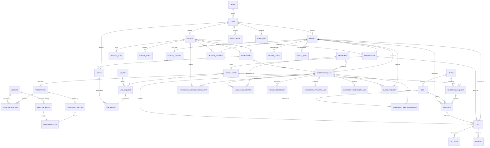

# Entity-Relationship (ER) Diagram
## MediVault / MediCare 3NF Relational Schema

### Key Normalization & Integrity Highlights
- **Single-Column Surrogate/Subtype Keys**: All 34 base tables use single-column primary keys (`2NF` by construction).
- **3NF Derivation Chains**:
  - `APPOINTMENT.doctor_id -> DOCTOR.department_id -> DEPARTMENT`
  - `PRESCRIPTION.consultation_id -> CONSULTATION.appointment_id -> APPOINTMENT.(patient_id, doctor_id)`
  - `BED.ward_id -> WARD.(ward_name, floor_no, daily_rate)`
  - `BILL -> BILL_ITEM` and `BILL -> PAYMENT` (summarized via `vw_bill_summary`).
