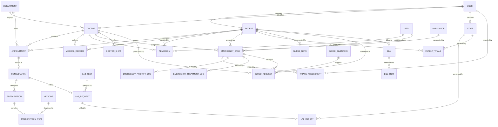

# Entity-Relationship (ER) Diagram
## MediCare Database Architecture

The following Mermaid diagram represents the complete relational entity model of MediCare, including core hospital entities, the Emergency Ward, dynamic triage tracking, and resource inventory:

### Key Cardinalities & Constraints
- `USER` to `PATIENT`/`DOCTOR`/`STAFF`: 1-to-1 extension table inheritance.
- `APPOINTMENT` to `CONSULTATION`: 1-to-0..1 (only completed appointments yield clinical consultations).
- `EMERGENCY_CASE` to `TRIAGE_ASSESSMENT`: 1-to-Many (supports initial triage and subsequent clinical reassessments).
- `EMERGENCY_CASE` to `EMERGENCY_PRIORITY_LOG`: 1-to-Many (strict immutable audit trail for every priority escalation or override).
- `BED` to `EMERGENCY_CASE`: 1-to-0..1 active allocation enforced by row-level locking.
