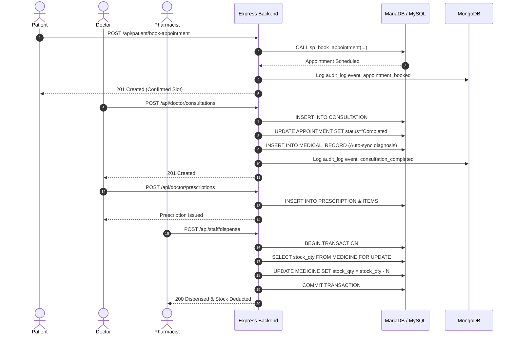
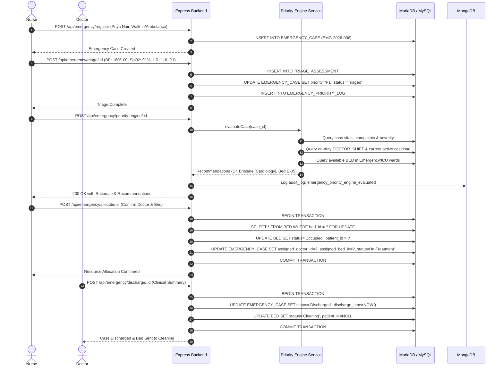
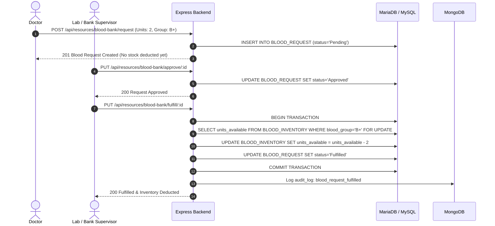

# Sequence Diagrams
## Critical Hospital Workflows

### 1. Normal Patient Outpatient Workflow

---

### 2. Emergency Ward & Signature Priority Engine Workflow

---

### 3. Blood Bank Lifecycle & Inventory Transfusion Workflow

